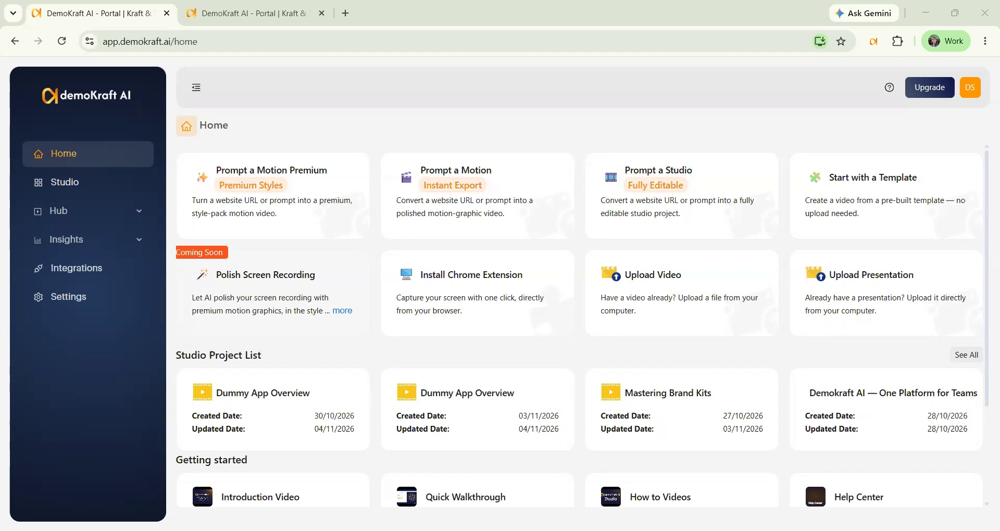
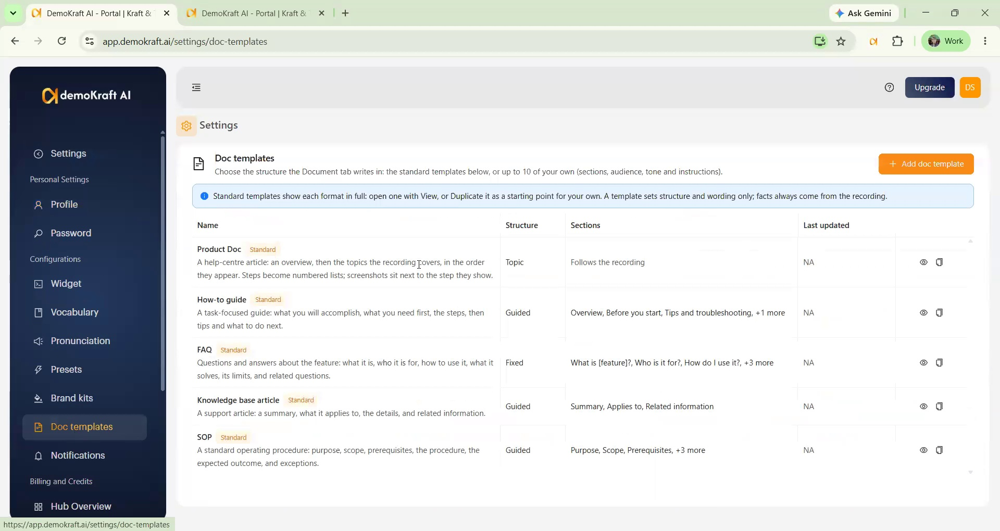
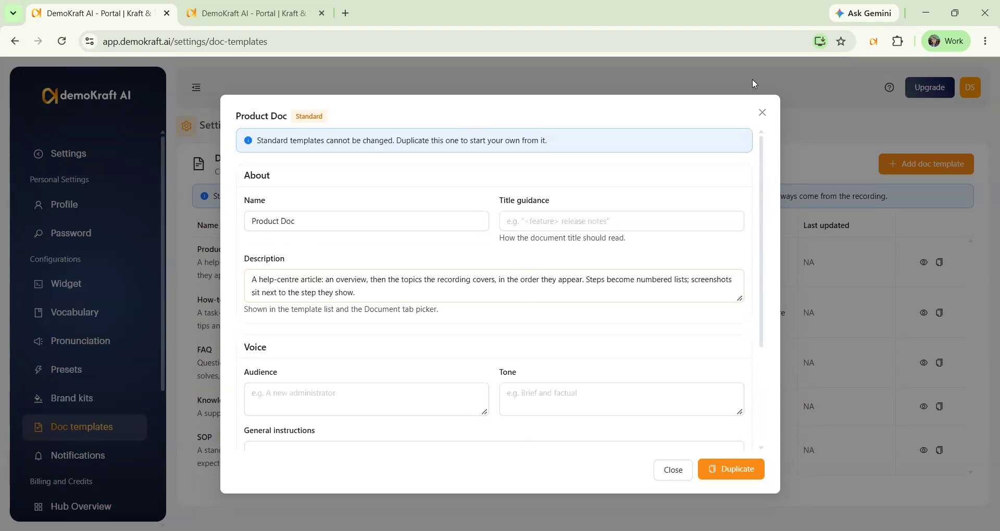
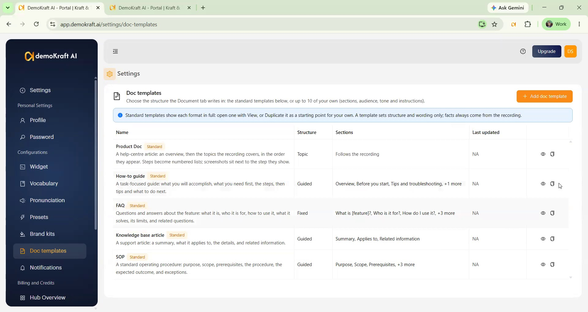
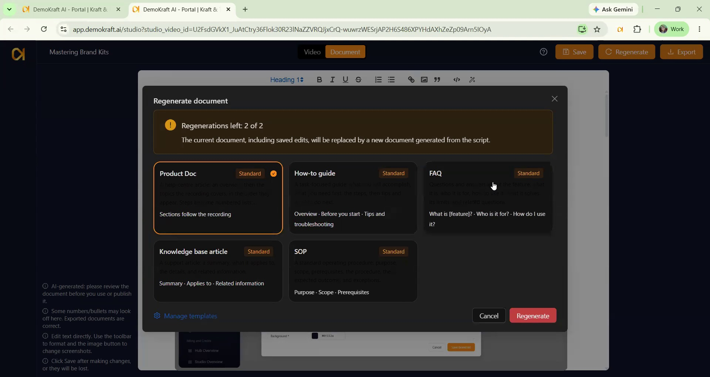

<Frame>
<iframe width="560" height="315" src="https://www.youtube.com/embed/IKBvnEbGQWQ?si=KiCmvwkSVhqqN2PK" title="Doc Templates" frameborder="0" allow="accelerometer; autoplay; clipboard-write; encrypted-media; gyroscope; picture-in-picture; web-share" referrerpolicy="strict-origin-when-cross-origin" allowfullscreen></iframe>
</Frame>

## Overview

Demokraft AI writes a document from the script of a Studio project in the **Document** tab (see [Generate Guide/Doc](/ai-studio/generate-doc)). A **doc template** decides how that document is organised and written: which sections it has, in what order, what each section should cover, who the reader is and what tone to use.

Doc templates apply to Studio projects created from an **extension recording**, an **uploaded video**, or an **uploaded presentation**. Use them to turn one video into a help-centre article, a how-to guide, an FAQ, a knowledge base article, or a standard operating procedure (SOP).

<Frame>
  
</Frame>

### What a template does, and what it doesn't

A template shapes the **presentation** of the document. The **facts** always come from your video's script:

- If a template asks for something the video doesn't mention, that part is left out rather than made up.
- Greetings, sign-offs and the narrator's general remarks about the product are left out so the document stays on topic. Concrete facts such as a limit, or the uses the video names, are kept.
- A value you use only to demonstrate (a sample word you type, "the third row") is not written as the reader's step. The step is described in general terms and your sample appears once, as an example.
- A template does not control fonts, colours or page layout. Those stay the same for every document.

## Review the standard templates

From the Demokraft AI home page, open **Settings** and select **Doc templates** under **Configurations**. The standard templates are listed first, marked **Standard**.

<Frame>
  
</Frame>

| Template | Best for | What you get |
|---|---|---|
| **Product Doc** | A general help-centre article (the default) | An overview, then one section per topic of the video, in the order they appear |
| **How-to guide** | Walking someone through one task | Overview, Before you start, the steps, Tips and troubleshooting, Next steps |
| **FAQ** | People evaluating or new to a feature | What is it? Who is it for? How do I use it? What problem does it solve? Limitations, Related questions |
| **Knowledge base article** | Support articles people look up | Summary, Applies to, the details, Related information |
| **SOP** | A procedure that must be done the same way every time | Purpose, Scope, Prerequisites, Procedure, Expected outcome, Exceptions and escalation |

Sections marked as optional (for example "Before you start" or "Are there any limitations?") are left out when the video says nothing about them, or nothing that another section hasn't already said.

Standard templates cannot be changed, but **View** (the eye icon) shows every setting and section, so they are the best way to learn how a template is built.

<Frame>
  
</Frame>

## Create your own doc template

You can have up to **10** custom templates. Custom templates can be edited, duplicated and deleted. Deleting or editing a template does not change documents that were already generated with it.

<Steps>
  <Step title="Start from a copy or from scratch">
    On the **Doc templates** page, use **Duplicate** (the copy icon) on the standard template closest to what you want. This creates an editable copy named "Copy of ...". Or select **Add doc template** to start from a blank template.

    <Frame>
      
    </Frame>
  </Step>

  <Step title="Fill in About">
    | Setting | What it does |
    |---|---|
    | **Name** (required) | Shown in the template list and the picker. Each template needs its own name. |
    | **Title guidance** | How the document title should read, for example `"<feature> release notes"`. |
    | **Description** | A short explanation shown in the template list and the picker. It helps you and your team choose; the writer doesn't use it. |
  </Step>

  <Step title="Set the Voice">
    | Setting | What it does |
    |---|---|
    | **Audience** | Who the reader is, for example "A new administrator". The writer adjusts its words and level of detail to this reader. One-click suggestions below the box (End users and customers, Business users, Administrators, Developers, Technical teams, Sales teams, Employees and internal teams, Management and decision makers) fill it in, and you can still type your own. If you leave it empty, the document is written for general business users with basic product knowledge. |
    | **Tone** | How the document should sound, for example "Brief and factual". |
    | **General instructions** | Instructions for the whole document, for example "Use the term 'workspace', never 'project'". |

    These three shape *how* the document is written. They can't add facts that are not in the video, and they can't make the writing promotional.
  </Step>

  <Step title="Choose a Structure">
    | Mode | What happens | Good for |
    |---|---|---|
    | **Fixed** | The document has exactly your sections, in your order, and nothing else. | FAQs, checklists, any format you need every time |
    | **Guided** | Your sections are always there, in your order. Studio adds extra sections between and after them when the video covers more topics. | Guides where you want a set start and end but a flexible middle |
    | **Topic** | No section list. Sections follow the topics of the video, like a Product Doc, but with your audience, tone, instructions and title. | Keeping the Product Doc structure with your own voice |
  </Step>

  <Step title="Define the Sections (Fixed and Guided only)">
    Add up to 12 sections. Use the arrows to move a section up or down, and the bin icon to remove it.

    | Setting | What it does |
    |---|---|
    | **Heading** | The section title. Put one word in [square brackets] to have it filled in from the video, for example `What is [feature]?` becomes "What is Smart Captions?". Headings are written in the project's language. |
    | **Level** | **Main heading (H2)** or **Sub-heading (H3)**. The first section must be a main heading. |
    | **Content shape** | **Summary** (a short introduction), **Prose** (paragraphs), **Steps** (a numbered list of actions, with screenshots), **Labelled list** (items with a short label each), or **Free-form** (follows your instruction exactly; needs an instruction). |
    | **Instruction** | What this section should say, for example "List only the limitations the video states". |
    | **Optional** | When on, the section is left out if the video has nothing for it. When off, the section always appears. |
    | **Give the writer the whole script** | Lets the section draw on the whole video instead of one part of it. See below. |
  </Step>

  <Step title="Save the template">
    Click **Create** (or **Save** when editing). The editor lists anything that needs fixing before it saves:

    - The template needs a name that no other template uses.
    - A **Fixed** template needs at least one section.
    - In **Fixed** and **Guided** templates, at least one section must be required (Optional off) **and** use its own part of the video (whole script off). This gives every part of your video a place.
    - A free-form section needs an instruction.
    - A heading can contain only one [placeholder].
    - If the template is too long, shorten the instructions.

    Once saved, the template appears in the Document tab picker of every project.
  </Step>
</Steps>

### "Give the writer the whole script"

Studio splits your video into parts and normally gives each part to **one** section. That section writes about its own part of the video and shows screenshots from it, so every part of the video lands in the document exactly once.

Some sections don't belong to one part of the video. "Who is it for?" or "What problem does it solve?" may draw on something said at the start and something said near the end. For those, turn on **Give the writer the whole script**:

- The section doesn't take a part of the video. Its writer reads the whole script and answers the section's instruction from anywhere in it.
- It is written after the other sections and avoids repeating what they already say.
- It has **no screenshots**, because it isn't tied to one moment in the video.
- It still uses only facts from the script.

Leave it **off** for sections that walk through or describe a specific part of the video. It can't be turned on for a **Steps** section, because steps always come from their own part of the video so their screenshots match.

<Tip>
  If a section that reads the whole script is **not** optional and the video has nothing for it, the section shows "This information is not available." Turn on **Optional** for such sections if you would rather they were left out.
</Tip>

### Tips for good templates

- **Start from a standard template.** Duplicate the one closest to what you want and change it.
- **Write instructions about the reader's need**, not about the video. "Explain what happens after export" works better than "Summarise minute three".
- **Make "nice to have" sections optional** so short videos don't get empty sections.
- **Use Steps for anything the viewer clicks through.** That is where screenshots appear.
- **Keep the number of sections modest.** A short video with twelve sections makes thin sections.

## Generate a document with a template

<Steps>
  <Step title="Open the Document tab">
    Open your project in Studio and click the **Document** tab at the top of the editor. Your video script is the input, so open the tab only after the script is final.
  </Step>

  <Step title="Choose a template">
    The first time, a window asks you to choose a template. **Product Doc** is already selected. The window lists the standard templates first, then your custom templates. Each card shows the template's description and its first few section headings, so you can see the structure before you choose. **Manage templates** opens the Settings page where you create your own.

    If you close the window without choosing, click **Generate document** in the Document tab to open it again.
  </Step>

  <Step title="Generate">
    Pick a template and click **Generate**. Writing the document takes a minute or so. Afterwards you can edit text, rewrite it with AI and swap screenshots as described in [Generate Guide/Doc](/ai-studio/generate-doc).
  </Step>
</Steps>

## Regenerate in a different template

After a document exists, click **Regenerate** at the top of Studio, next to **Save**, and pick another template.

<Frame>
  
</Frame>

<Warning>
  **Regenerating replaces the current document**, including any edits you made to it. Export a copy first if you want to keep it.
</Warning>

- You can regenerate **twice per project**. The window shows how many regenerations you have left.
- Screenshots are taken again for the new document. Documents you exported earlier keep their own screenshots.
- If the chosen template could not be applied, Studio writes a Product Doc instead and the Document tab tells you so. That attempt does not use up a regeneration, so you can try again.

## Copied and translated projects

When you copy or translate a project, the copy keeps the template you chose and gets its own two regenerations.
