<iframe
  className="w-full aspect-video rounded-lg"
  src="https://www.youtube.com/embed/AQbLDM5AMsM"
  title="Overview of Scene Options"
  allow="accelerometer; autoplay; clipboard-write; encrypted-media; gyroscope; picture-in-picture"
  allowFullScreen
></iframe>

## Overview of Scene Options

Scenes are short animated title cards placed between the parts of your recording. The system provides three scene options that can be applied to your project:

- **Intro:** opens the video. It is always placed first.
- **Chapter break:** introduces the next section. It is placed after the playhead.
- **Outro:** closes the video with a thank-you, a call to action, or your website. It is always placed last.

Each scene becomes its own segment on the timeline, plays in the editor straight away, and is part of the exported video.

<Note>
  Please note Scenes section is not available for Template or Prompt based video projects.
</Note>

<Frame>
  
</Frame>

<Tip>
  You can also have a [preset](/ai-studio/preset) add an intro and an outro for you, with the same templates, brand kit, and logo as this panel.
</Tip>

## Accessing Scene Options in Studio Mode

Open your existing project in studio mode to access the scene options. The scenes section is located on the left-hand side of the interface.

<Frame>
  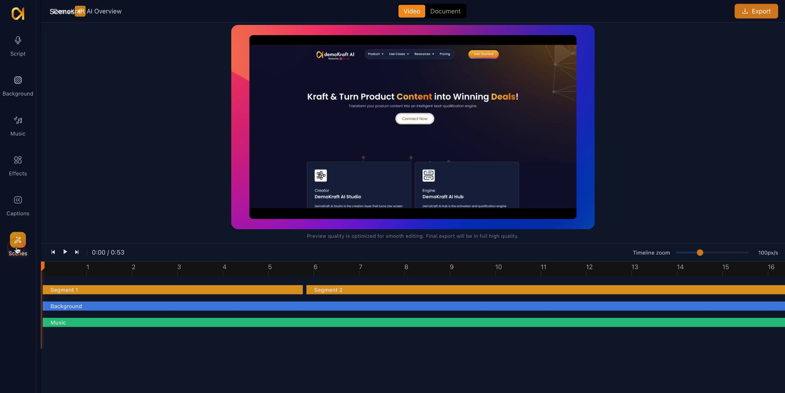
</Frame>

## Available Scene Types

There are three primary scene template options:

1. Intro Template
2. Outro Template
3. Chapter Break Template

You select one of these to customize and add to your project.

<Frame>
  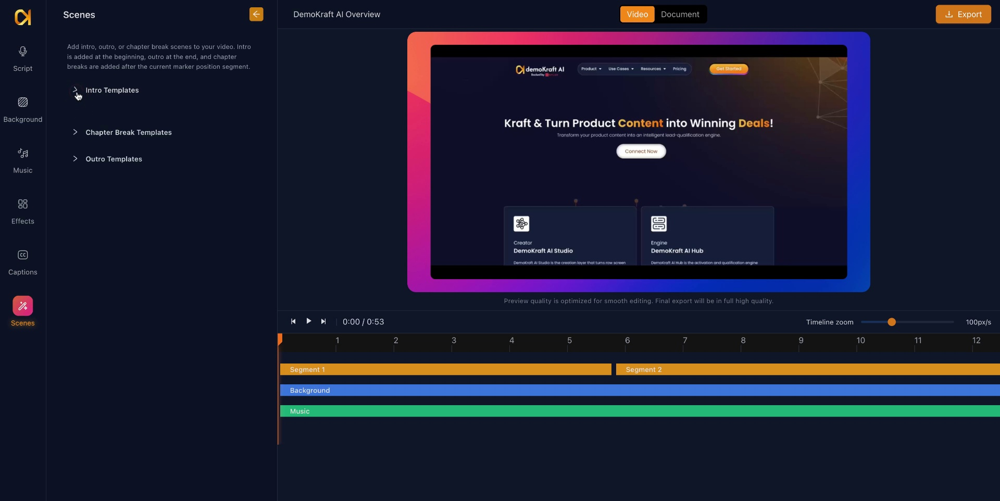
</Frame>

## Choosing a template

The Scenes panel has three lists: **Intro Templates**, **Chapter Break Templates**, and **Outro Templates**. Every card plays a live preview. Click a card, or **Add**, to open its settings.

| Intro | Chapter break | Outro |
|---|---|---|
| Spotlight intro | Spotlight chapter | Spotlight outro |
| Aurora intro | Aurora chapter | Aurora outro |
| Kinetic intro | Kinetic chapter | Kinetic outro |
| Frame intro | Frame chapter | Frame outro |
| Mosaic intro | Mosaic chapter | Mosaic outro |
| Bold brand reveal | Chapter card | Clean brand close |
| Clean slate | Section divider | CTA close |
| Split screen | Transition wipe | Recap summary |

Spotlight, Aurora, Kinetic, Frame, and Mosaic each come as an intro, a chapter break, and an outro in the same style, so the three look like they belong together:

- **Spotlight:** calm and brand-led, with a dark background, a soft ring pulse, and your brand name with an accent line.
- **Aurora:** a soft color gradient that drifts slowly, large titles rising word by word, and a chapter progress bar.
- **Kinetic:** poster style, with big bold lines sliding in, an accent block across one word, and a large outlined chapter number.
- **Frame:** editorial, with a thin frame that draws itself, a small top row, and large text in the lower part.
- **Mosaic:** geometric tiles (squares, circles, half and quarter circles) in your colors popping in beside the text.

<Note>
  The step-by-step sections further down show one example template. The settings differ by template: some have a background tone list and others have color pickers, and some have a **Body Font** setting. Each template's panel shows exactly the settings it has.
</Note>

## Settings that apply to every template

Every template's settings are listed in its panel. The common ones:

- **Text:** title, subtitle, brand name, tagline, button text, website, chapter label and number, and so on, depending on the template.
- **Colors:** background, text, and accent. Aurora and Mosaic also have primary and secondary colors. Some templates pick the background from a short list of tones instead.
- **Fonts:** **Font** sets the headings in every template. The Spotlight, Aurora, Kinetic, Frame, and Mosaic templates also have **Body Font** for smaller text such as taglines, labels, and links. Both list the platform font catalog.
- **Duration:** a slider with a range that depends on the template, between about 1 and 6 seconds across all templates.

### Text in other languages

If the chosen font cannot show some of your text, for example a Hindi or Marathi title in a Latin brand font, or English words in a font made for another script, that text is shown in a matching font for the language. This happens in the editor and in the exported video. The rest of the text keeps your font.

### Required fields

Required fields are marked with an asterisk. The scene cannot be applied while they are empty:

- Spotlight intro and outro: **Brand Name**.
- Aurora, Kinetic, Frame, and Mosaic intros: **Title**.
- Bold brand reveal and Clean brand close: **Brand Name**.
- Clean slate and Chapter card: **Title**.
- Split screen: **Brand Mark** and **Title**.
- Section divider: **Section Title**.
- CTA close: **Cta Label** (the button text).
- Recap summary: **Items**.

Every other field is optional. Leave it empty and the scene lays itself out without it. For example, a Spotlight, Aurora, Kinetic, Frame, or Mosaic chapter break can show just "Chapter 02".

### Good to know

- **Kinetic intro, Highlighted word:** the word that gets the accent block. If it is empty, or the title does not contain it, the last word is highlighted.
- **Chapter number and Total chapters:** Aurora shows "Chapter 2 of 5" with a progress bar, and Frame shows a timeline with a dot at the current chapter.
- Long titles shrink and wrap to fit. Very long ones end with "…".

Press **Apply** to render the scene. The preview in the editor is what the exported video shows.

## Brand kit

If your account has [Brand Kits](/ai-studio/brand-kit), the Scenes panel shows a **Brand kit** selector above the template lists. Your default kit is selected to start with. Choose another kit, or **None** to use the template colors. If you have no kits yet, the panel shows a **Create a brand kit** link instead.

- The template cards show the selected kit's colors, fonts, and brand texts.
- A new scene starts with the kit's colors, fonts, company name, tagline, website, and button text. An intro's title starts as your project name. A chapter title is never filled in.
- These are ordinary settings. Change any of them before you press **Apply**. Choosing another kit later does not change scenes you already added.
- To restyle an existing scene with the selected kit, open it and press **Apply brand kit**. It sets the colors, fonts, and logo, and fills only empty text fields (never the title). Then press **Apply** to render it.

The project remembers which kit you chose.

## Logo

Every template can show an optional logo from your brand kit. When the selected kit has a logo, or the scene already has one, a **Logo** field appears at the end of the scene's settings.

- When the selected kit has a logo, new scenes get it. The light or dark version is chosen to read well on the color behind it.
- Choose **No logo** to leave it out. The scene keeps that choice, even after **Apply brand kit**.
- A logo from another kit stays available as **Current logo**. If a logo file was deleted in Settings, the form says so and the scene renders without it.

## Applying an Intro Template

To apply an intro template, click on the Intro Template option. Then choose your preferred template from the available options by clicking the add button next to it.

<Frame>
  
</Frame>

## Customizing the Intro Title

After adding the intro template, customize it as needed using different template config options. The title starts as your project name. Change it to reflect your content.

<Frame>
  
</Frame>

## Adding an Intro Subtitle

You can also add a subtitle in the intro template to provide additional context or welcome message.

<Frame>
  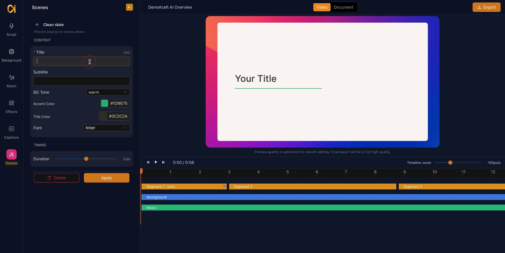
</Frame>

## Selecting Background Tone for Intro

On templates with a background tone list, choose an option such as Warm, Cool, or Pure White to set the mood and appearance of your intro scene. Other templates use color pickers instead.

<Frame>
  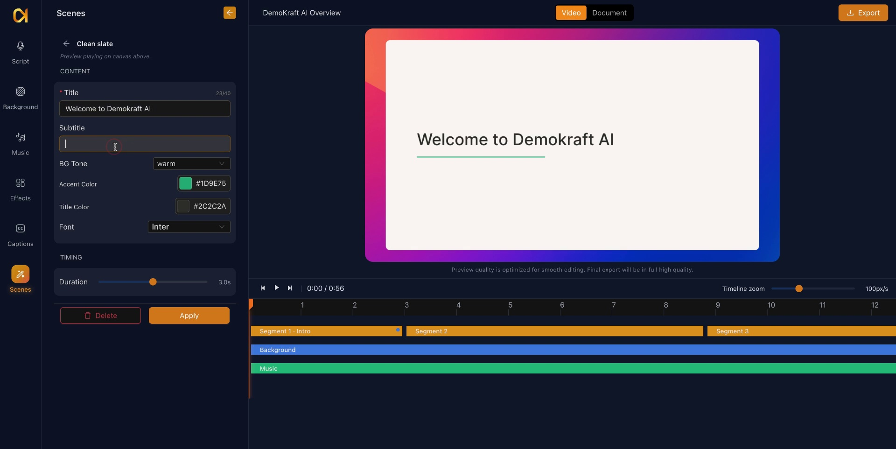
</Frame>

## Choosing Accent Color

Select an accent color that aligns with your brand identity to customize the visual elements of the intro scene.

<Frame>
  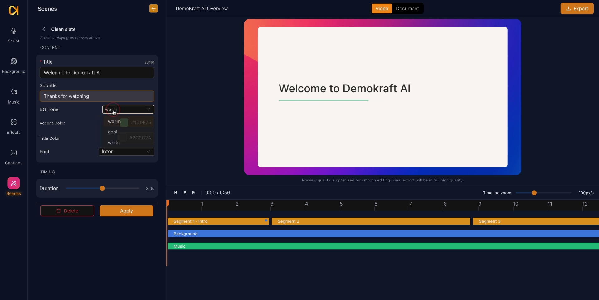
</Frame>

## Accent Color Application

Apply the chosen accent color to enhance branding consistency within your intro template.

<Frame>
  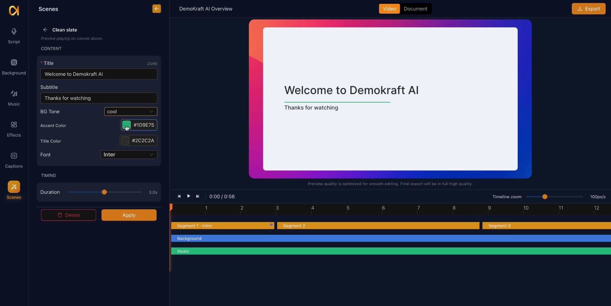
</Frame>

## Title Color and Font Style Customization

Adjust the title color as needed, keeping visual harmony in mind. Select a font style, such as Poppins, to match your design preferences. Some templates also let you pick a separate Body Font for the smaller text.

<Frame>
  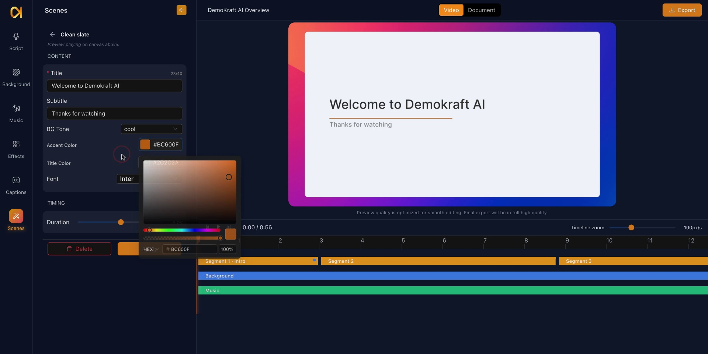
</Frame>

## Setting Intro Scene Duration

Control the display duration of the intro scene by increasing or decreasing the time. For example, you can set it to 4 seconds. The available range depends on the template.

<Frame>
  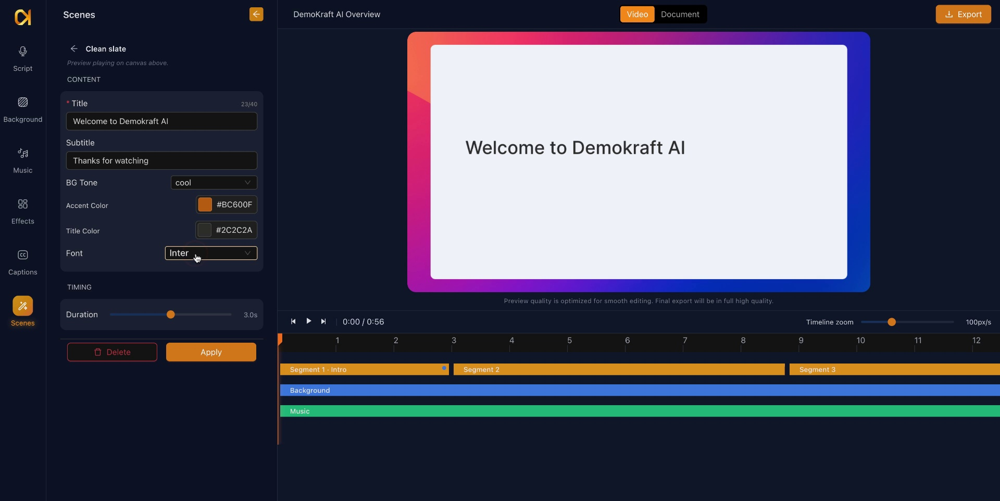
</Frame>

## Applying the Intro Template

Click the Apply button to generate and add the intro segment to the beginning of your project. This action finalizes the intro's inclusion.

<Frame>
  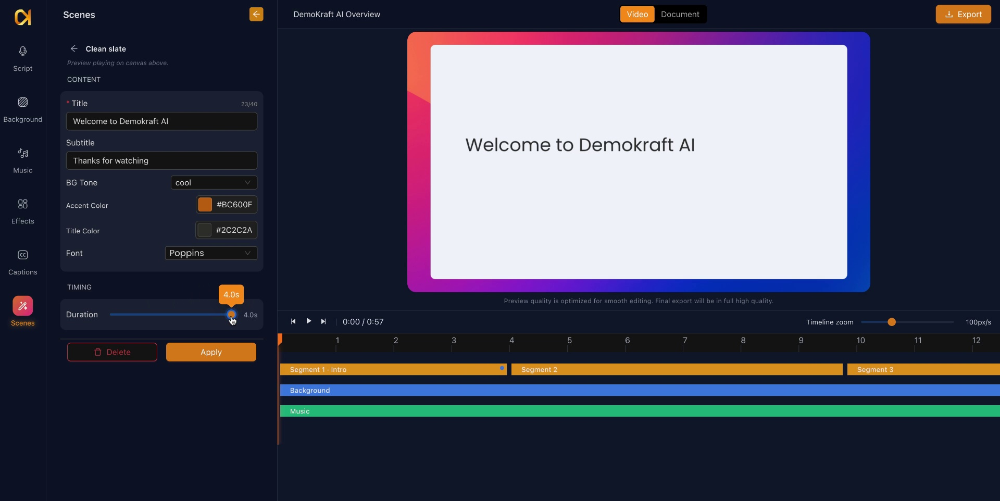
</Frame>

## Accessing and Applying Chapter Breaks

Navigate back to the scenes section to select the Chapter Break option. You can apply chapter breaks at any point within your project timeline to segment content. Place the player marker on a scene after which you want to add the Chapter break. Add the Chapter break template from options. Scene will get added to your video.

<Frame>
  
</Frame>

## Choosing a Chapter Break Template

Select a chapter card template from the available chapter break options by clicking the add button.

<Frame>
  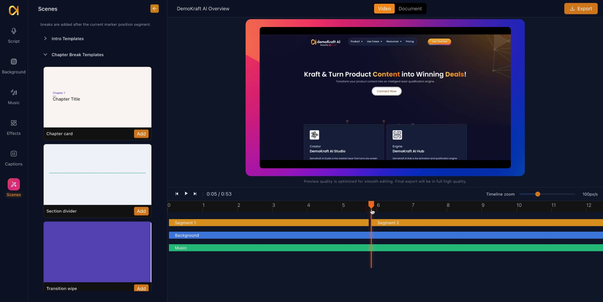
</Frame>

## Configuring Chapter Break Label and Number

Specify the chapter label text and the chapter number to clearly identify and organize different sections within your project.

<Frame>
  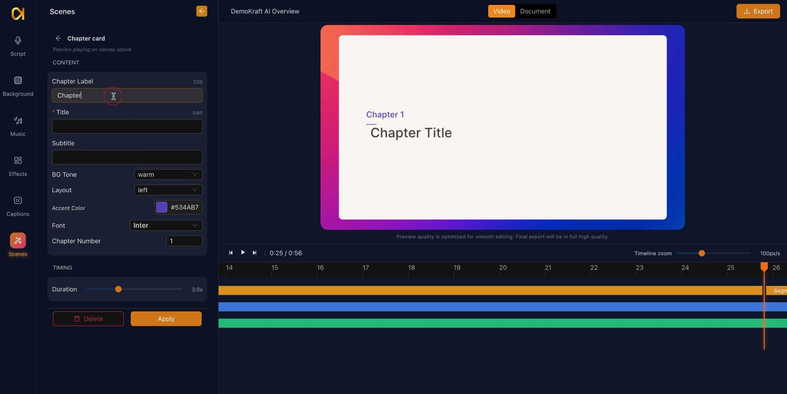
</Frame>

## Defining Chapter Title

Enter the title of the chapter to indicate its content focus.

<Frame>
  
</Frame>

## Adding a Subtitle to Chapter Break

Include a subtitle for the chapter break scene to provide supplementary information or welcoming text.

<Frame>
  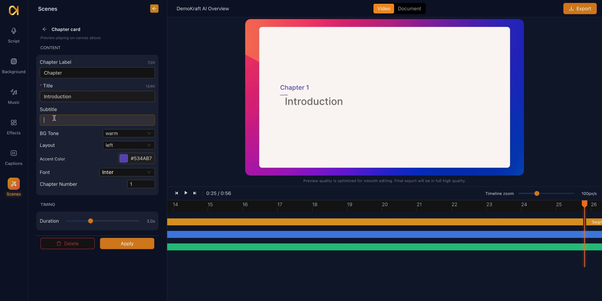
</Frame>

## Selecting Background Tone and Layout for Chapter Break

Choose the background tone, such as cool, and set the layout alignment (left, right, or center) of the chapter break scene.

<Frame>
  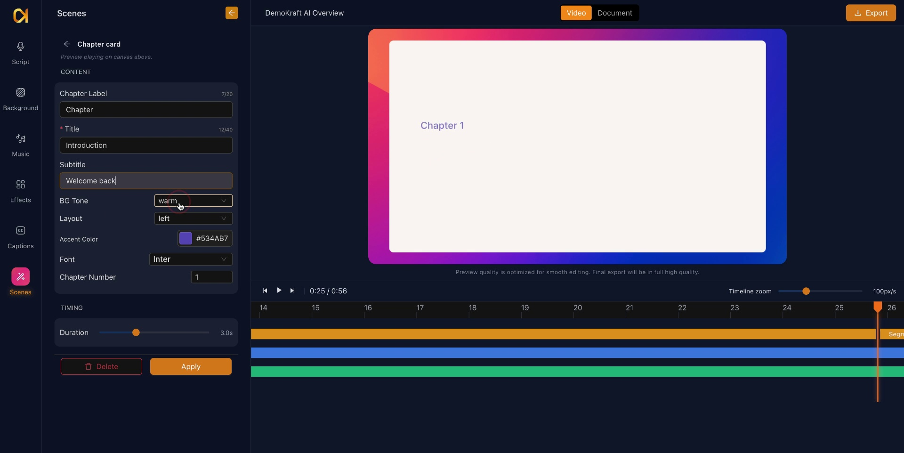
</Frame>

## Customizing Brand Color for Chapter Break

Select the brand color to maintain visual consistency for the chapter break scene.

<Frame>
  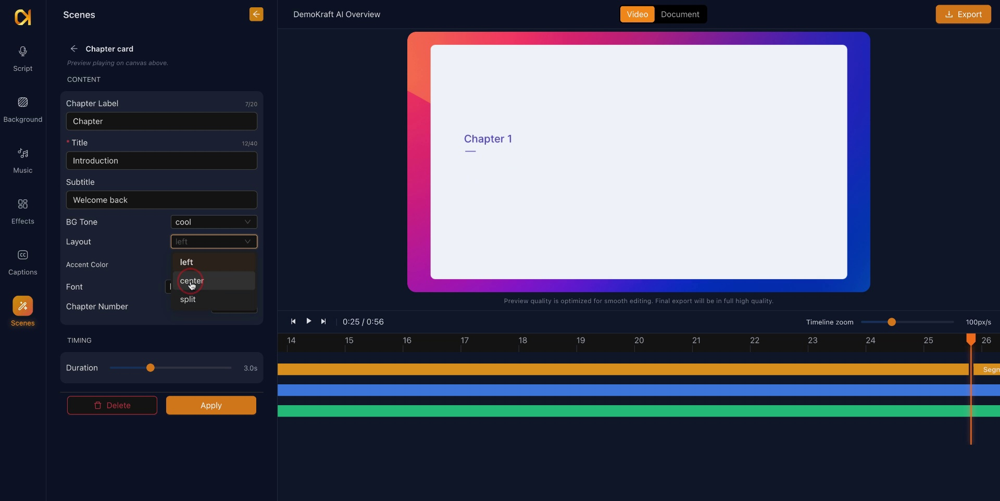
</Frame>

## Setting Font and Chapter Number Display

Choose a font type and confirm the chapter number display styling within the chapter break card.

<Frame>
  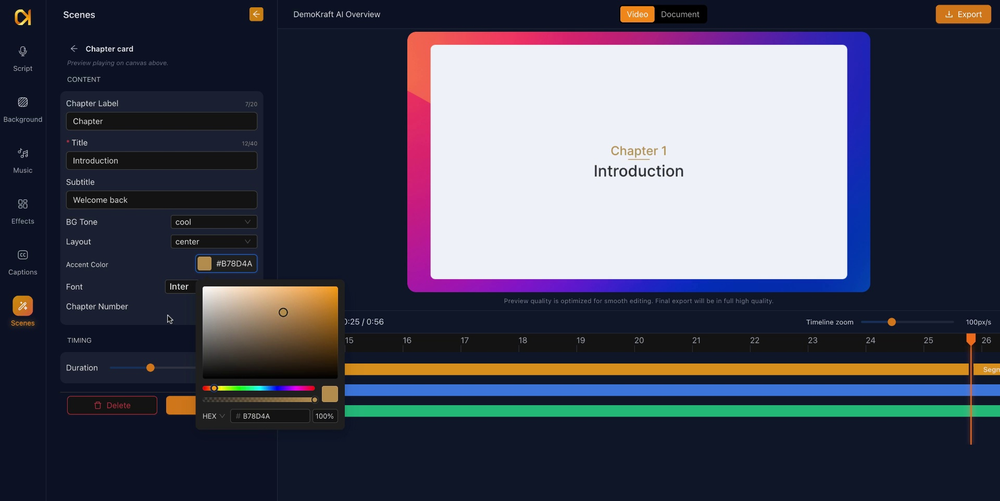
</Frame>

## Adjusting Chapter Break Duration and Applying

Set the scene duration with the slider. The range depends on the template. Click Apply to add the chapter break to your project timeline.

<Frame>
  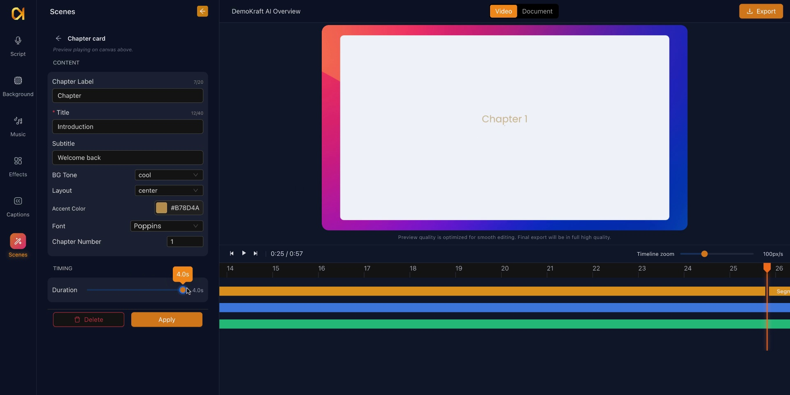
</Frame>

## Applying Outro Templates

Similar to Intro and Chapter break scenes, you can add an Outro scene. Access multiple outro templates from the Scenes panel to select and add an appropriate ending scene to your project.

<Frame>
  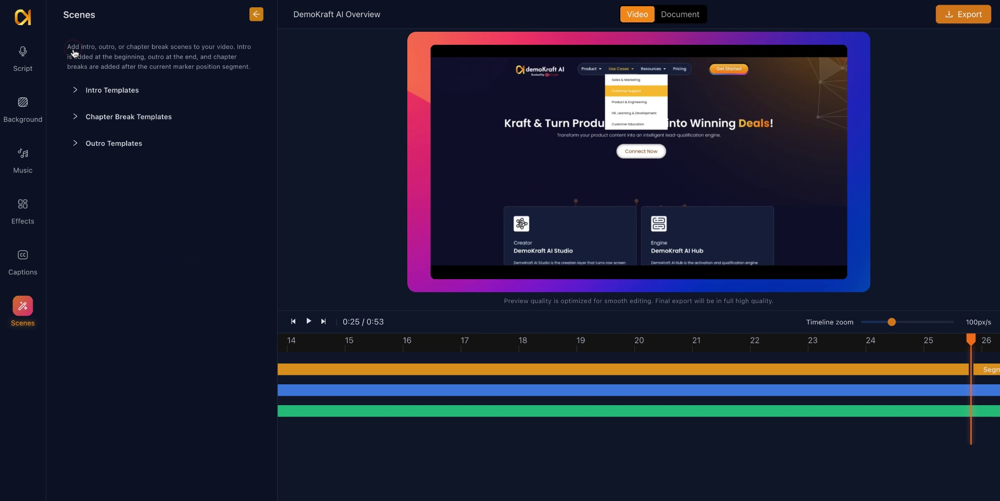
</Frame>

## Customizing Outro Headline

Modify the headline text within the outro template to deliver your desired closing message.

<Frame>
  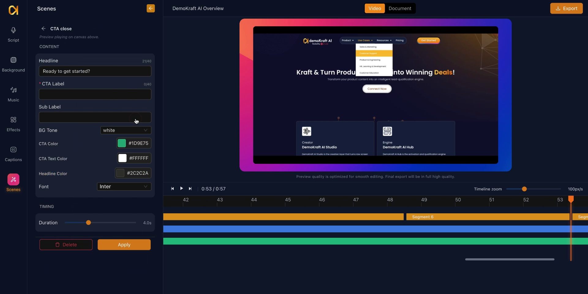
</Frame>

## Setting Call to Action (CTA) Label

Configure the CTA button label within the outro template, selecting from available button options such as "Sign Up".

<Frame>
  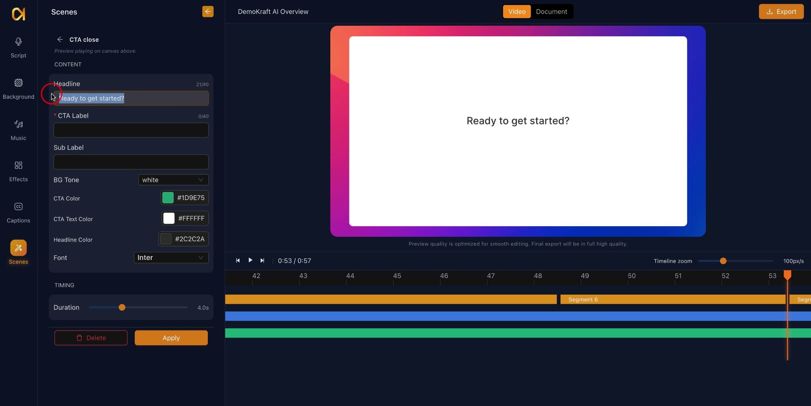
</Frame>

## Adding Outro Subtitle

Include a subtitle or secondary label to complement the outro scene's messaging.

<Frame>
  
</Frame>

## Customizing Outro Colors and Fonts

Adjust colors for various outro elements including background, CTA button, CTA text, and headline. Select a font style consistent with your branding.

<Frame>
  
</Frame>

## Setting Outro Timing and Applying

Define the timing duration for the outro scene and click Apply to integrate it into your project.

<Frame>
  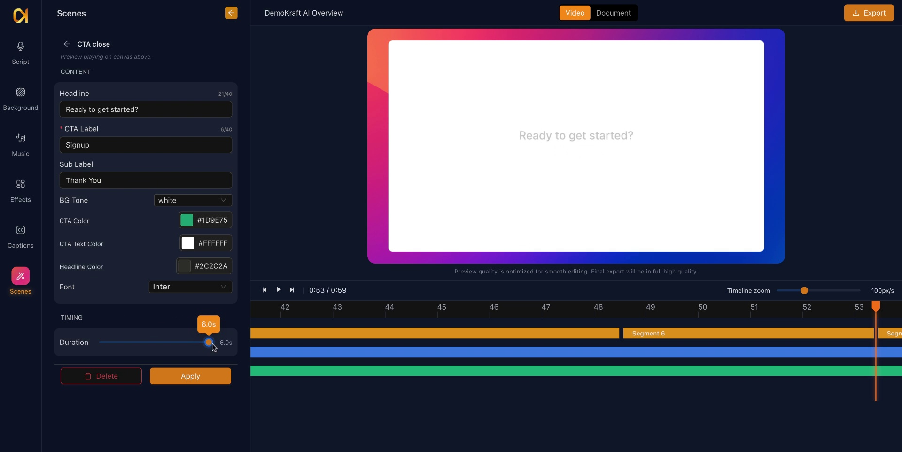
</Frame>

## Managing Scene Additions

You can add and configure multiple chapters, as well as apply intro and outro templates, to structure your project effectively.

<Frame>
  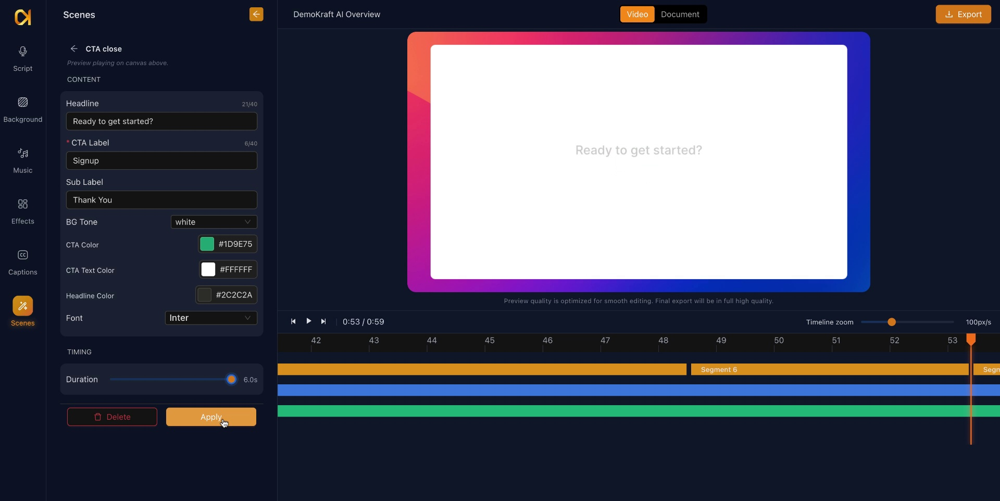
</Frame>

## Scene videos are rendered once

**Apply** turns the scene into a short video, and the export uses that video. A scene therefore keeps the look it had when you last applied it. To pick up a change made later, for example a different brand kit or a font improvement on the platform, open the scene and press **Apply** again.

## Changing or removing a scene

- Click the scene on the timeline to open its settings again, change them, and press **Apply**.
- Right-click the scene on the timeline and choose **Delete Scene** to remove it.
- Adding an intro when the video already has one gives you two. Delete the one you do not want. A [preset](/ai-studio/preset) is the one place that replaces the existing intro or outro instead of adding another.

## Presets

A preset (Settings, then Presets) can add an intro and an outro for you, with the same templates, settings, brand kit, and logo as this panel. When you apply it, it replaces the project's current intro at the start and outro at the end. See the [Preset Config guide](/ai-studio/preset).

## Translation

With **Translate scene text** on, a translated video also gets its scene text translated, except the website field. Both the heading font and the body font switch to one that supports the new script, and those scenes are rendered again with the logo they had. A scene whose text and fonts did not change keeps its earlier video. See the [Translate guide](/ai-studio/translate) for what gets translated.
