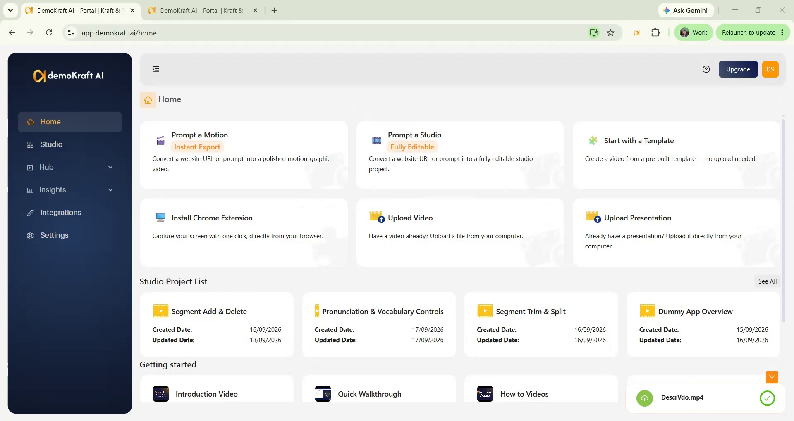
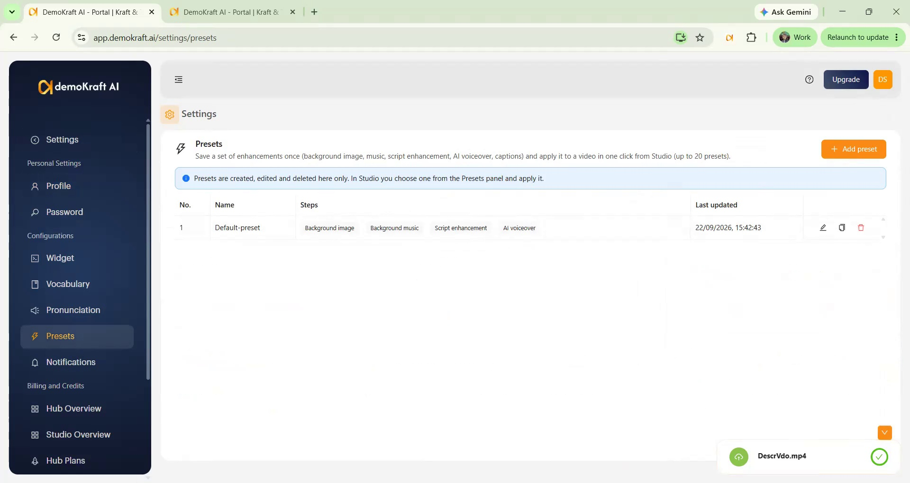
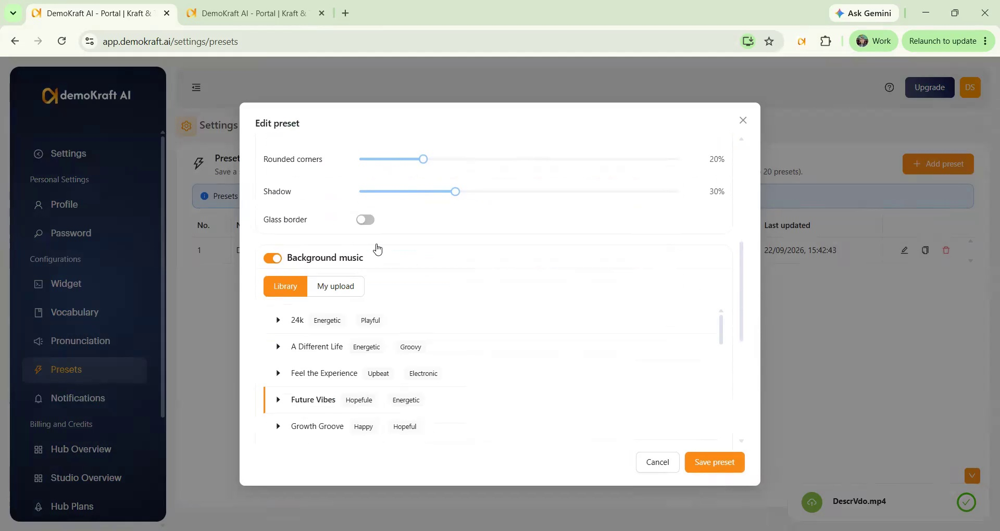
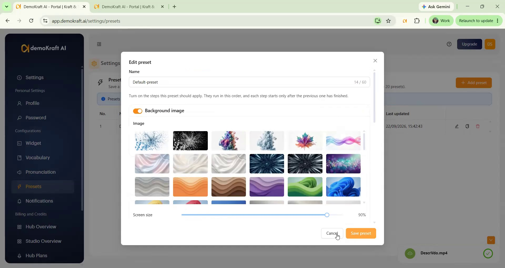
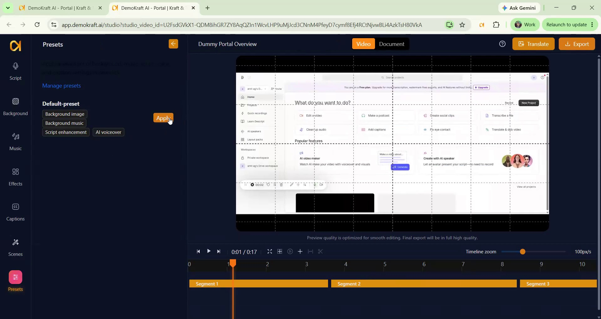
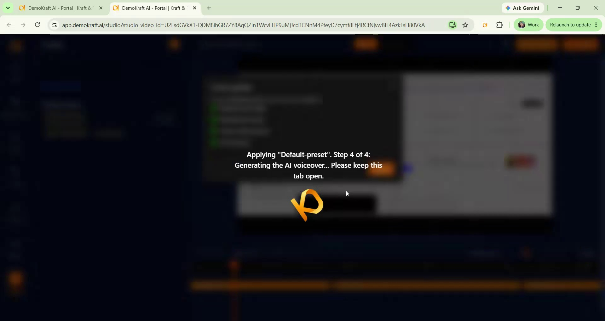

<Frame>
<iframe width="560" height="315" src="https://www.youtube.com/embed/SZZS4Ssipz4?si=JKEzOvou08CZj985" title="YouTube video player" frameborder="0" allow="accelerometer; autoplay; clipboard-write; encrypted-media; gyroscope; picture-in-picture; web-share" referrerpolicy="strict-origin-when-cross-origin" allowfullscreen></iframe>
</Frame>

## Preset config overview

Preset Config in Demokraft combines multiple video polishing operations into one reusable action for Studio projects created through **extension recording, video uploads, or presentation uploads**.

You can include Background image, Music, Script enhancement, AI voice-over, and Captions in a preset instead of configuring each operation separately.

<Note>
  Presets are not available for projects created from a template, Prompt a Studio, Prompt a Motion, or Prompt a Motion Premium.
</Note>

Configure presets, apply them to projects with **Apply**, and review the processed video.

## Create and manage presets

Use Preset Configs to combine video polishing operations into reusable presets while keeping control over whether to apply or adjust each operation individually.

<Steps>
  <Step title="Open preset settings">
    Open Preset Configuration and go to **Settings**. Preset Settings is where you can add a new preset and manage existing presets. You can create up to 20 presets for different use cases like marketing, product demos, training, and other video workflows.

    <Frame>
      
    </Frame>

    <Frame>
      
    </Frame>
  </Step>

  <Step title="Configure operations and save">
    Add a new preset, or edit, duplicate, or delete an existing preset. Select the operations to include in the preset (with any combination):

    1. Name the preset.
    2. Enable Background image, and choose the image settings you normally use in Studio Editor.
    3. Configure Music config.
    4. Script enhancement.
    5. AI voice-over config.
    6. Captions config.

    Finally save the preset. Once saved, it becomes available in your video project.

    Each operation is independent. For example, a preset can generate an AI voice-over from your current script without Script enhancement, or add Captions without an AI voice-over. Captions follow the spoken audio, so for a presentation, which has no audio of its own, they appear only once it has an AI voice-over.

    <Frame>
      
    </Frame>

    <Frame>
      
    </Frame>
  </Step>
</Steps>

## Apply a preset to a project

Use the Presets panel to choose a preset, apply its configured operations, and verify the completed video.

<Steps>
  <Step title="Select a preset">
    Open the Presets panel and review the preset’s configured operations, including Background image, Music, Script enhancement, AI voice-over, and Captions. Select the preset you want to use.

    <Frame>
      
    </Frame>
  </Step>

  <Step title="Apply the preset">
    Select **Apply**. Review the confirmation warning that existing configurations may be overridden, then confirm to start processing. Demokraft processes each configured operation in sequence, and the progress can be monitored as the workflow runs.

    - You can close the tab; processing continues and the progress shows again when you come back.
    - While a preset is applying, you cannot start another operation on the project.
    - If a step fails, the steps already completed are kept and the remaining steps are skipped. The summary shows what was applied and what was not.

    <Frame>
      
    </Frame>
  </Step>

  <Step title="Review the video">
    When processing is complete, play back the video with all selected operations applied to verify the final result. Continue editing afterward to make additional individual adjustments and retain control over the finished video.
  </Step>
</Steps>