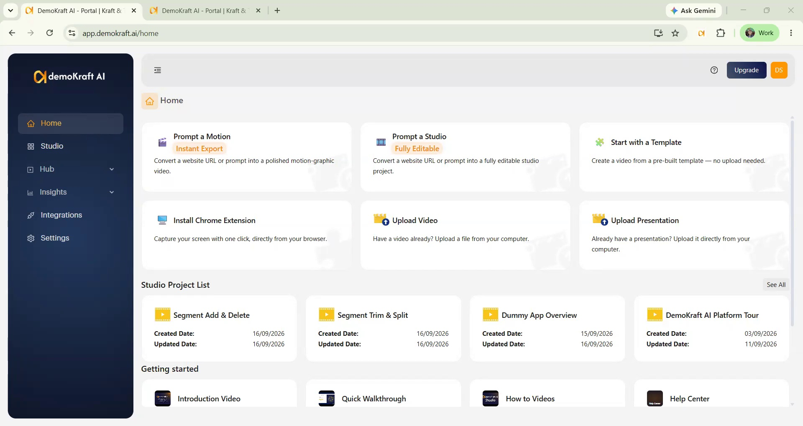
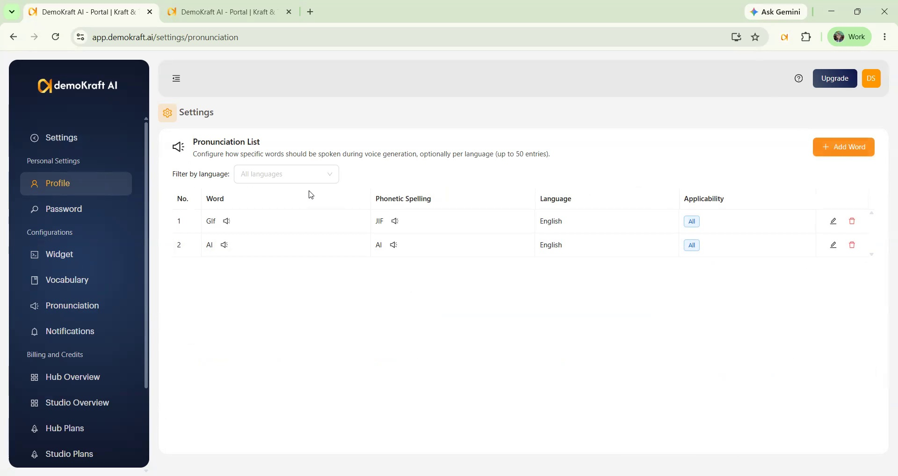
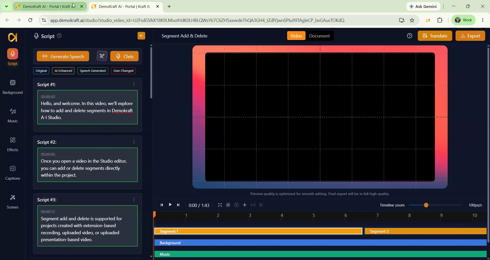

<Frame>
<iframe width="560" height="315" src="https://www.youtube.com/embed/ovhuvoVtvdI?si=Htjiqw9LrzkwCIRb" title="YouTube video player" frameborder="0" allow="accelerometer; autoplay; clipboard-write; encrypted-media; gyroscope; picture-in-picture; web-share" referrerpolicy="strict-origin-when-cross-origin" allowfullscreen></iframe>
</Frame>

## Overview

Demokraft provides Pronunciation and Vocabulary features for controlling how important words are spoken and spelled in generated content.

Pronunciation affects how key words are pronounced by AI, while Vocabulary controls how those words are spelled in generated scripts and documents, helping keep content brand-aligned.

Configure both features in **Settings** to keep generated content consistent.

## Configure pronunciation

Use **Pronunciation** in **Settings** to define how configured words are spoken during AI voice-over generation.

<Steps>
  <Step title="Open Pronunciation settings">
    Open **Pronunciation** in **Settings**. The Pronunciation configuration opens, where you can add words and define how they should be pronounced.

    <Frame>
      
    </Frame>
  </Step>

  <Step title="Add words and phonetic pronunciations">
    Select **Add Word**, enter the word and its phonetic spelling (how it sounds, for example "Dem-oh-Kraft"), then choose the language and the **Applicability**:

    - **All languages** — use this pronunciation whatever language the voice-over is in.
    - **This language only** — use it only for voice-overs in the selected language.

    You can add several rows for one word, for example an **All languages** row plus a French-only row. A **This language only** row always wins for its language. The pronunciation list changes only what the AI voice says, never the text on screen.

    <Frame>
      
    </Frame>

    When a configured word appears during AI voice-over generation, AI pronounces it according to its specified phonetic spelling.
  </Step>

  <Step title="Preview the pronunciation">
    Each row has two speaker icons: one plays the word as typed (the mispronunciation you are fixing), the other plays your phonetic spelling. Use them to fine-tune the spelling before you rely on it. The language filter above the table shows the rows for one language.
  </Step>
</Steps>

## Configure vocabulary

Vocabulary controls how specific words are spelled in generated scripts and documents. Use it for uncommon or brand-specific terms such as Demokraft, which AI models may otherwise transcribe with “Kraft” spelled c-r-a-f-t instead of k-r-a-f-t.

<Steps>
  <Step title="Open Vocabulary settings">
    Open Vocabulary in **Settings**. The Vocabulary configuration opens.
  </Step>

  <Step title="Add standardized terms">
    Add each uncommon or brand-specific term you want to standardize with its required spelling, for example here word Demokraft is added with “Kraft” spelled k-r-a-f-t.
  </Step>

  <Step title="Generate content with configured spelling">
    Generate new scripts and documents using the configured spelling. Demokraft appears consistently with “Kraft” spelled k-r-a-f-t, reducing manual corrections to spelling.
  </Step>
</Steps>

<Frame>
  
</Frame>

<Frame>
  
</Frame>

## Good to know

- **Use both lists for one word if needed.** Vocabulary fixes spelling, Pronunciation fixes sound; one does not fix the other.
- **Applies to every project.** Both lists work for recorded, uploaded, presentation, template, and prompt-generated projects, and for Translate. There is nothing to set per project.
- **Limits:** up to 50 words in the Vocabulary list and up to 50 rows in the Pronunciation list. A word with rows in three languages counts as three rows.
- **New content only.** A change applies to scripts, documents, and voice-overs you generate afterwards. To fix an existing project, run script enhancement or AI voice-over on it again.

<Tip>
  Still mispronounced? Check that the row's language matches the language of the voice-over. A French-only row does nothing for an English voice-over.
</Tip>